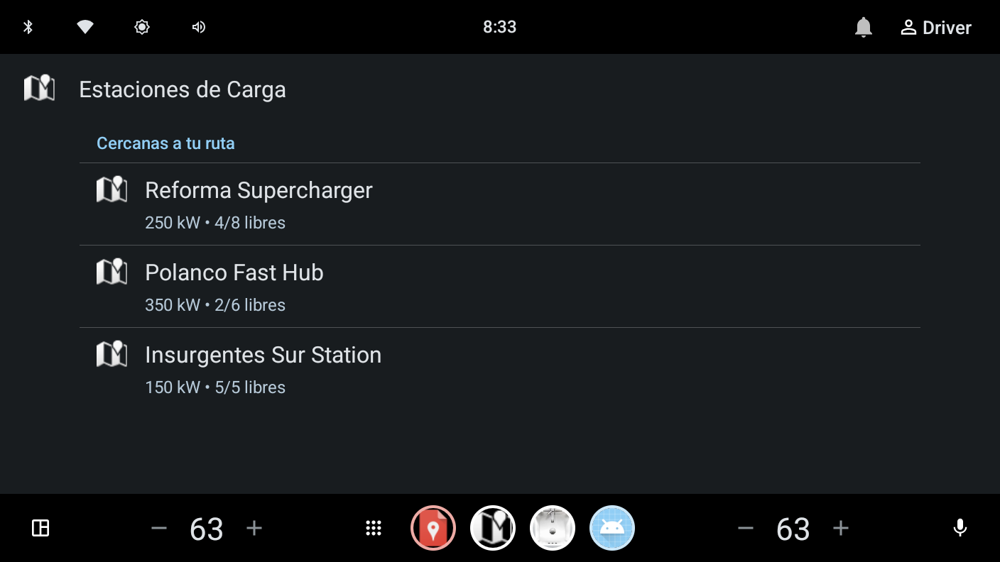
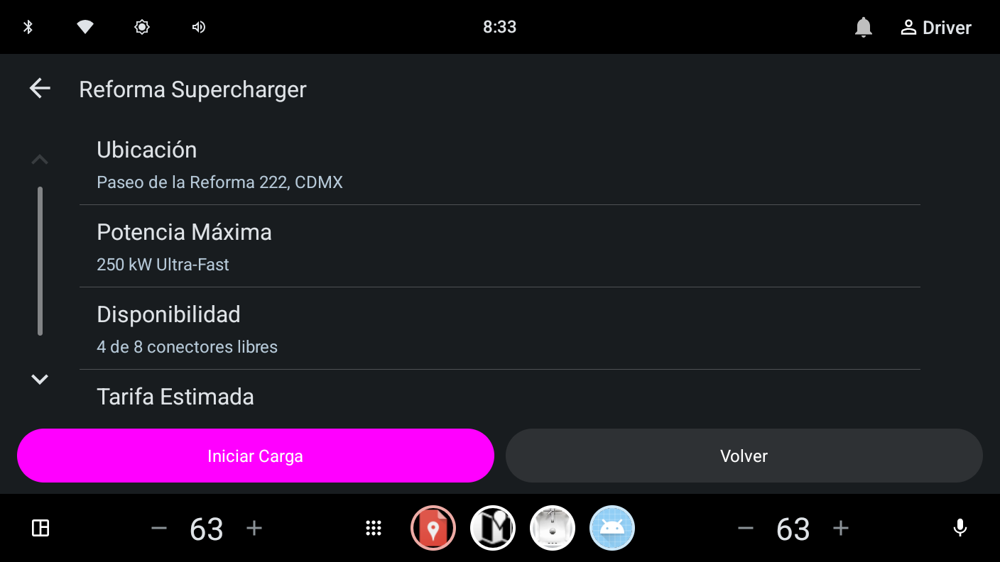
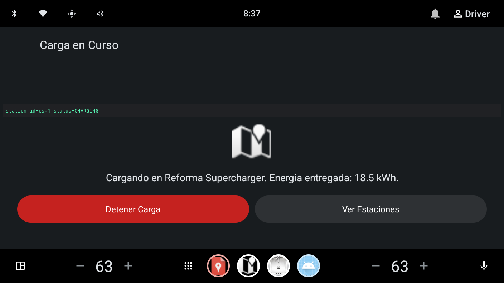

<p align="center">
  
</p>

<h1 align="center">kmp-auto</h1>

<p align="center">
  <em>The Unified In-Car Automotive Library & Starter Template for Kotlin Multiplatform.<br>Write once in <code>commonMain</code> — render natively on <strong>Android Auto</strong>, <strong>Android Automotive OS</strong>, and <strong>Apple CarPlay</strong>.</em>
</p>

<p align="center">
  <a href="https://kotlinlang.org/docs/multiplatform.html"></a>
  <a href="https://developer.android.com/training/cars/apps"></a>
  <a href="https://developer.apple.com/carplay/"></a>
  <a href="PROGRESS.md"></a>
  <a href="LICENSE"></a>
  <a href="https://github.com/jesusdmedinac/KMP-CLI"></a>
</p>

---

## 🌟 Why `kmp-auto`?

Automotive applications differ fundamentally from standard mobile apps: **the vehicle head unit does not render arbitrary canvas or freeform UI**. Due to strict driver distraction regulations established by the **NHTSA** and vehicle manufacturers, both Google (`androidx.car.app`) and Apple (`platform.CarPlay`) enforce **template-driven architectures**:
- **Android Auto & Automotive OS**: Interfaces must be expressed using `ListTemplate`, `PaneTemplate`, `GridTemplate`, or `MessageTemplate` rendered by the car's system host.
- **Apple CarPlay**: Interfaces must be expressed using `CPListTemplate`, `CPInformationTemplate`, `CPGridTemplate`, or `CPAlertTemplate` managed by `CPInterfaceController`.

Until now, teams had to build **two entirely separate native automotive codebases**, duplicating domain models, navigation stacks, distraction limit handling, and reactive state flows.

**`kmp-auto` eliminates this fragmentation**:
1. **100% Shared Logic in `commonMain`**: Write screens, navigation, state handling, and template definitions once.
2. **Symmetric Native Projection**: Zero-business-logic platform engines (`AndroidTemplateMapper` and `IosTemplateMapper`) translate shared templates into official native templates at runtime.
3. **Safety-First Navigation (`BackstackGuard`)**: Automatically enforces the strict 5-step car screen backstack limit required by car head units, preventing fatal app termination while driving.
4. **Dual Adoption Workflow**: Consume as a standalone modular library (`:core`) in existing projects, or scaffold turnkey in-car applications using the official template via [KMP CLI](https://github.com/jesusdmedinac/KMP-CLI).

---

## 🚀 Key Architectural Pillars

```
                              ┌──────────────────────────────────────────────┐
                              │          commonMain (Shared In-Car)          │
                              │  AutoScreen · AutoNavigator · BackstackGuard │
                              └──────────────────────┬───────────────────────┘
                                                     │
                             ┌───────────────────────┴───────────────────────┐
                             │                                               │
                             ▼                                               ▼
               ┌───────────────────────────┐                   ┌───────────────────────────┐
               │        androidMain        │                   │          iosMain          │
               │   AndroidTemplateMapper   │                   │     IosTemplateMapper     │
               │   AndroidNavigatorAdapter │                   │  IosNavigatorCoordinator  │
               └─────────────┬─────────────┘                   └─────────────┬─────────────┘
                             │                                               │
                             ▼                                               ▼
               ┌───────────────────────────┐                   ┌───────────────────────────┐
               │    androidx.car.app       │                   │      platform.CarPlay     │
               │ (Android Auto & AAOS Host)│                   │ (CPTemplateApplication)   │
               └───────────────────────────┘                   └───────────────────────────┘
```

- **Strict Multiplatform Boundary Hygiene**: `commonMain` contains zero imports from `android.*` or `platform.CarPlay.*`. Platform engines only project templates declaratively.
- **Reactive Dynamic Updates**: State updates driven by Kotlin Coroutines (`StateFlow`) trigger automatic invalidation (`screen.invalidate()`) on Android Auto and dynamic section updates (`updateSections`) on CarPlay.
- **Backstack Safety Enforcement**: `BackstackGuard` provides customizable policies (`REPLACE_TOP`, `THROW_EXCEPTION`, `IGNORE`) to strictly respect automotive hardware safety bounds.

---

## 📊 Template Equivalency Matrix

| Shared Template (`commonMain`) | Android Auto / AAOS (`androidx.car.app`) | Apple CarPlay (`platform.CarPlay`) | Status |
| :--- | :--- | :--- | :---: |
| **`AutoListTemplate`** | `ListTemplate` | `CPListTemplate` | ✅ Available |
| **`AutoGridTemplate`** | `GridTemplate` | `CPGridTemplate` | ✅ Available |
| **`AutoPaneTemplate`** | `PaneTemplate` | `CPInformationTemplate` | ✅ Available |
| **`AutoMessageTemplate`** | `MessageTemplate` | `CPAlertTemplate` | ✅ Available |
| **`AutoSearchTemplate`** | `SearchTemplate` | `CPSearchTemplate` | ⏳ Milestone 6 |
| **`AutoTabBarTemplate`** | `TabTemplate` | `CPTabBarTemplate` | ⏳ Milestone 6 |
| **`AutoPointOfInterestTemplate`** | `PlaceListMapTemplate` | `CPPointOfInterestTemplate` | 📅 Planned |

---

## 🛠️ Dual Adoption Modes

### Mode 1: Library Integration (Existing Projects)
Add `kmp-auto-core` directly to your multiplatform project dependencies:

```kotlin
// build.gradle.kts
kotlin {
    sourceSets {
        commonMain.dependencies {
            implementation("io.github.kmpauto:core:1.0.0")
        }
    }
}
```

### Mode 2: Turnkey Scaffolding with [KMP CLI](https://github.com/jesusdmedinac/KMP-CLI) (New Projects)
The recommended way to scaffold, diagnose, and run `kmp-auto` applications is using the open-source **KMP CLI**:

```bash
# 1. Verify host environment (Android SDK, Automotive emulator, Xcode)
kmp doctor --architecture

# 2. Scaffold a complete in-car project with Android Auto & CarPlay shells
kmp create MyCarApp --template kmp-auto --package com.example.carapp

# 3. Add AI Coding Agent skills for in-car development
kmp skills add kmp-auto
```

> 💡 **Synergy with KMP CLI**: When scaffolding via `kmp create --template kmp-auto`, the project automatically provisions companion skills (`kmp-auto-expert`, `carplay`, `android-cli`) into your workspace so AI coding assistants (Antigravity, Claude Code, Cursor) immediately understand automotive constraints.

---

## 💻 Quick Start & Code Example

### 1. Define an In-Car Screen in `commonMain`

```kotlin
import io.github.kmpauto.core.components.AutoAction
import io.github.kmpauto.core.components.AutoListItem
import io.github.kmpauto.core.navigation.AutoNavigator
import io.github.kmpauto.core.navigation.AutoScreen
import io.github.kmpauto.core.template.AutoListTemplate
import io.github.kmpauto.core.template.AutoTemplate

class StationListScreen(
    private val navigator: AutoNavigator
) : AutoScreen() {

    override fun render(): AutoTemplate {
        val items = listOf(
            AutoListItem(
                title = "Reforma Supercharger",
                subtitle = "8 stalls available · 250 kW",
                onClick = {
                    navigator.push(StationDetailScreen(navigator, "Reforma Supercharger"))
                }
            ),
            AutoListItem(
                title = "Polanco Fast Charger",
                subtitle = "4 stalls available · 150 kW",
                onClick = {
                    navigator.push(StationDetailScreen(navigator, "Polanco Fast Charger"))
                }
            )
        )

        return AutoListTemplate(
            title = "Charging Stations",
            items = items,
            headerAction = AutoAction(
                title = "Back",
                onClick = { navigator.pop() }
            )
        )
    }
}
```

### 2. Define an Information Pane with Primary Actions

```kotlin
import io.github.kmpauto.core.components.AutoAction
import io.github.kmpauto.core.components.AutoPaneItem
import io.github.kmpauto.core.navigation.AutoNavigator
import io.github.kmpauto.core.navigation.AutoScreen
import io.github.kmpauto.core.template.AutoPaneTemplate
import io.github.kmpauto.core.template.AutoTemplate

class StationDetailScreen(
    private val navigator: AutoNavigator,
    private val stationName: String
) : AutoScreen() {

    override fun render(): AutoTemplate {
        return AutoPaneTemplate(
            title = stationName,
            items = listOf(
                AutoPaneItem(title = "Status", value = "Available"),
                AutoPaneItem(title = "Power Output", value = "250 kW DC Fast"),
                AutoPaneItem(title = "Pricing", value = "$4.50 / kWh")
            ),
            actions = listOf(
                AutoAction(
                    title = "⚡ Start Charging",
                    isPrimary = true,
                    onClick = {
                        navigator.push(ChargingActiveScreen(navigator))
                    }
                )
            ),
            headerAction = AutoAction(
                title = "Back",
                onClick = { navigator.pop() }
            )
        )
    }
}
```

---

## 📱 Live Execution Verification

The sample app (`:sample`) demonstrates an **EV Charging & POI Workflow** running on a live **Android Automotive OS emulator** (`Automotive_1408p_landscape`):

| Screen 1: Station List (`AutoListTemplate`) | Screen 2: Station Detail (`AutoPaneTemplate`) | Screen 3: Charging Active (`AutoMessageTemplate`) |
| :---: | :---: | :---: |
|  |  |  |

---

## 🗺️ Roadmap & Development Plan

Development strictly follows the [5-Step AI Planning Process](https://github.com/jesusdmedinac/kmp-auto/blob/main/docs/features) with BDD Gherkin specifications and scenario-by-scenario TDD:

- **Milestone 1: Living Foundation** ✅
  - Multiplatform library build setup with `androidx.car.app 1.7.0` and iOS `-framework CarPlay`.
- **Milestone 2: Navigation & Backstack Safety** ✅
  - `AutoNavigator` with `BackstackGuard` (5-step depth limit enforcement and pop handling).
- **Milestone 3: Core Declarative Templates** ✅
  - `AutoListTemplate`, `AutoGridTemplate`, `AutoPaneTemplate`, and `AutoMessageTemplate`.
- **Milestone 4: Native Platform Engines** ✅
  - `AndroidTemplateMapper` and `IosTemplateMapper` with reactive invalidation.
- **Milestone 5: Sample Application & Automotive Verification** ✅
  - Multiplatform EV Charging sample app verified live on Android Automotive OS emulator.
- **Milestone 6: Advanced In-Car Templates** ⏳ *In Progress*
  - `AutoSearchTemplate` (live search with query filter & results list).
  - `AutoTabBarTemplate` (root-level container for multi-tab car apps).
  - `AutoActionSheetTemplate` (in-car contextual modal sheets).
- **Milestone 7: Interactive Template Showcase Suite** ⏳ *In Progress*
  - Dedicated showcase screens for every template in `:sample` (`TemplateCatalogScreen`).
- **Milestone 8: Apple CarPlay Shell & Host** 📅 *Planned*
  - `iosApp` runner with `CPTemplateApplicationScene` for testing on CarPlay Simulator.
- **Milestone 9: KMP CLI Template Packaging** 📅 *Planned*
  - Integration with `kmp create --template kmp-auto`.
- **Milestone 10: Official `kmp-auto-expert` Agent Skill** 📅 *Planned*
  - In-car guidelines, distraction rules, and automated runbooks for AI coding agents.
- **Milestone 11: Maven Central Publishing & Open Ecosystem** 📅 *Planned*
  - Publishing `io.github.kmpauto:core` to Maven Central.

Track detailed live progress in [`PROGRESS.md`](PROGRESS.md).

---

## 🤝 Contributing

Contributions are welcome! Please follow these guidelines:

1. **Behavior-Driven Development (BDD)**: Write Gherkin scenarios under `docs/features/` before introducing new behavior.
2. **Zero-Bloat Multiplatform Hygiene**: Keep `commonMain` pure; platform-specific APIs belong exclusively in `androidMain` or `iosMain`.
3. **Automated Testing**: Ensure all unit and integration tests pass:
   ```bash
   ./gradlew testDebugUnitTest
   ./gradlew :core:assemble
   ```
4. **Follow Conventional Commits**: e.g., `feat: add in-car search template [advanced_templates.feature:Scenario 1] #3`.

---

## 📄 License

```
Copyright 2026 Jesus Daniel Medina Cruz and kmp-auto contributors

Licensed under the Apache License, Version 2.0 (the "License");
you may not use this file except in compliance with the License.
You may obtain a copy of the License at

    http://www.apache.org/licenses/LICENSE-2.0

Unless required by applicable law or agreed to in writing, software
distributed under the License is distributed on an "AS IS" BASIS,
WITHOUT WARRANTIES OR CONDITIONS OF ANY KIND, either express or implied.
See the License for the specific language governing permissions and
limitations under the License.
```
